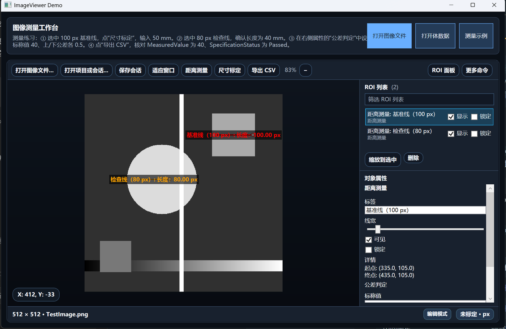
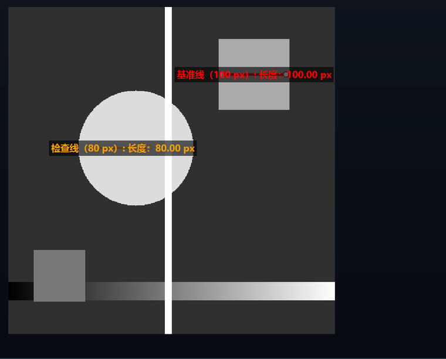
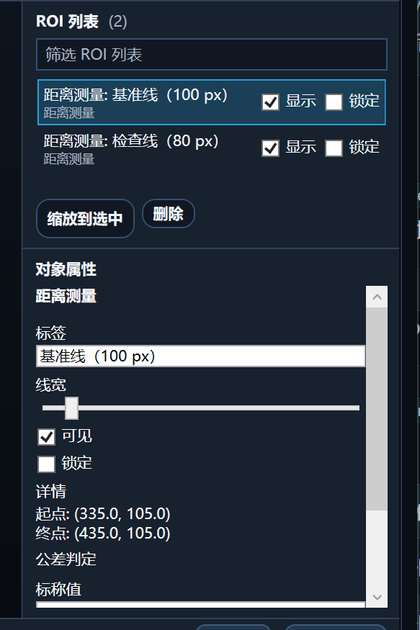
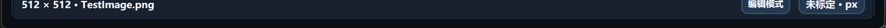

# ImageViewer 使用手册

> 适用版本 0.1.0（`net8.0-windows` / `net10.0-windows`）。校对日期 2026-11-12，依据提交 `2be5103`。
> 本手册讲界面操作，以演示程序 ImageViewerDemo 为例。嵌入自有 WPF 程序请读[集成指南](integration.md)。
> 记号约定：**粗体**是界面上的按钮或菜单命令；`等宽`是输入值、字段名或文件名。版本变化见[变更记录](../CHANGELOG.md)，离线阅读可用 [PDF 版](usage.pdf)。

<a id="start"></a>

## 启动与界面

直接启动已构建的 `ImageViewerDemo.exe`。如果从源码运行，在 Windows 上打开终端，进入仓库根目录，选择与本机 .NET SDK 对应的目标框架：

```powershell
dotnet run --project ImageViewerDemo/ImageViewerDemo.csproj --framework net10.0-windows
```

使用 .NET 8 时，把参数改为 `--framework net8.0-windows`。Demo 启动时通常会打开随程序附带的灰度测试图；没有看到图像时，可手动选择 **打开图像文件** 或 **测量示例**。加上 `--sample` 参数（例如 `ImageViewerDemo.exe --sample`）会跳过测试图，直接载入测量示例，适合演示和录屏。

**运行环境。** Windows 10 或更高版本；控件与 Demo 都提供 `net8.0-windows` 与 `net10.0-windows` 两份产物，按宿主的目标框架选择；需要可用的 DirectX 图形驱动，WPF 渲染依赖它。界面按系统 DPI 缩放，4K 屏 200% 缩放下布局与截图都以物理像素呈现；多显示器时窗口跟随所在屏幕的缩放比例。

| 区域 | 能做什么 |
| --- | --- |
| Demo 顶部 | **打开图像文件**、**打开体数据**、**测量示例**；打开过程中显示进度与 **取消加载**。 |
| 查看器工具栏 | 打开图像、保存会话、适应窗口、距离测量、尺寸标定、导出 CSV；“更多命令”进入完整菜单。 |
| 中间画布 | 浏览图像，绘制、选中并编辑 ROI。绘制时底部会显示当前工具、下一步提示与“取消”。 |
| 右侧 ROI 面板 | 查找、选择、锁定或隐藏 ROI；编辑选中项的属性。列表和属性可分别滚动。 |
| 底部状态栏 | 查看图像文件名、尺寸、交互模式、标定和未保存状态；悬停文件名或标定徽标可看详情。 |



窗口窄时，点 **ROI 面板** 展开右侧栏。如果常用工具被手动隐藏，点 **恢复工具栏**。在画布空白处右键也可打开完整菜单；在 ROI 上右键会先选中该对象，再显示与它相关的操作。

**查找命令。** 打开右键菜单后直接输入“槽孔”“显示灰度剖面图”等关键词。按 `↓` 移到第一个可执行结果；只有一个可执行结果时，可直接按 `Enter`。`Esc` 先清空搜索，再按一次关闭菜单。命令呈灰色时，悬停可查看缺少的图像、选区或其他条件。完整菜单树见[附录 B](#appendix-menu)，逐条说明见[右键菜单](context-menu.md)。

<a id="image"></a>

## 打开图像与浏览

1. 点击 **打开图像文件**、按 `Ctrl+O`，或把文件拖到画布。支持 `.png`、`.jpg`、`.jpeg`、`.bmp`、`.gif`、`.tif` 和 `.tiff`。
2. JPEG/TIFF 会按 EXIF Orientation 自动旋正，手机和相机照片不会横躺。单图解码上限约 1 亿像素（100,000,000），超过时程序拒绝解码并给出提示，而不是耗尽内存；这类图像请先在外部降采样或裁切后再打开。
3. 等待解码。耗时较长时可点 **取消加载**；失败后可根据提示检查文件，再点 **重试**。加载失败或取消不会替换当前文档。
4. 点击 **适应窗口**（`Ctrl+F`）看全图；在画布上双击也能适应窗口（正在用绘制工具时不生效）。把鼠标移到要检查的位置，滚轮缩放；按住中键拖动平移。
5. 检查细节时，可用 **实际大小（100%）** 查看 1:1 视图，或先选中 ROI，再用 **缩放到所选 ROI**。**填充窗口** 会让图像覆盖视口，边缘可能超出画布。
6. 需要改变观察方向时，用 **视图 → 向左旋转 90°**、**向右旋转 90°**、**水平翻转** 或 **垂直翻转**。标签、控制点与图像一起定位，旋转或翻转不会改变测量的图像坐标和数值。按 `Ctrl+0` 重置视图。

画布还接受两类拖放：直接拖入 `.ivsession` 或 `.ivpkg` 会按“打开项目或会话”的流程载入；拖入图像则按新文档打开。从体数据切片打开普通图像时，程序会保护当前文档和轴位视图的未保存编辑；确认替换并成功打开后，旧体数据退出，显示新的单图文档。

图像超过约 400 万像素时，程序自动启用多分辨率金字塔与分块渲染，并按 16 MP、64 MP 两档提高瓦片缓存上限；缩放平移只处理当前视口。相关开关与缓存清理在 **性能设置** 中。

<a id="roi"></a>

## 绘制与编辑 ROI

ROI 是图像上的感兴趣区域或测量对象。卡尺、拟合、基准这些词的确切含义见[术语表](terminology.md)。工具分三类：**绘制**标记区域、点或文字；**测量**记录尺寸、几何关系；**边缘检测**沿着你给的参考线或圆搜索真实边缘（卡尺、拟合、斑点）。画布底部的提示会随工具更新。全部 31 个工具见[附录 A](#appendix-tools)。

### 基础绘制与标注

| 要画什么 | 选哪个工具 | 操作 |
| --- | --- | --- |
| 矩形区域 | **矩形 ROI** | 拖出一个框；拖动控制点可旋转。 |
| 圆形或圆环 | **圆形 ROI** / **圆环 ROI** | 从圆心向外拖；圆环再拖内径。 |
| 椭圆 | **椭圆 ROI** | 拖出外接框，可旋转。 |
| 任意轮廓 | **多边形 ROI** | 依次单击顶点，回到起点或右键闭合。 |
| 折线或手绘曲线 | **折线 ROI** / **自由曲线 ROI** | 逐点单击；自由曲线按住左键连续画。 |
| 标一个点、箭头或说明 | **点标注** / **箭头标注** / **文本标注** | 点标注单击放置；箭头从起点按住左键拖到箭头尖端再松开；文本标注单击定位后，在弹出的对话框输入文字。 |

这些工具只画不测，适合圈出关注区域、写批注、给下游分析留位置。

### 常用测量

| 要做什么 | 选工具后如何操作 |
| --- | --- |
| 测两点间距离 | 选 **距离测量**。在起点按住左键，拖到终点后松开。 |
| 测折线路径长度 | 选 **折线测量**。依次单击各节点，至少两点；右键或双击结束。结果含总长度、线段数和最短／最长段。 |
| 测不规则区域面积 | 选 **面积测量**。沿边界依次单击至少三个顶点，回到起点闭合，也可右键完成。闭合后查看面积、周长和质心。 |
| 测夹角 | 选 **角度测量**，依次点第一条边上的点、顶点、第二条边上的点。 |
| 测圆弧或圆 | **圆弧测量**依次点起点、终点、弧上的第三点；**三点圆**在圆周点三个不共线的点。 |
| 测两个圆的中心距 | 先建立两个圆形测量对象，再选 **圆心距**，依次点击两个圆。 |
| 记录像素坐标 | 选 **点坐标测量**后单击。用 **自动边缘吸附点** 时先把指针移近边缘，看到候选位置后再单击。 |
| 拟合边缘或测宽 | **拟合直线**沿目标边缘拖出参考线；**宽度测量**横跨要测的两条边拖出参考线。**自动圆测量**在目标圆内部单击，程序查找圆边缘。 |



### 该用哪个工具

同一条边可以有多种测法，差别在于“谁决定边缘位置”：手工点哪就是哪、卡尺亚像素搜索、还是先拟合再算形位。

| 你的目标 | 推荐工具 | 理由 |
| --- | --- | --- |
| 只要尺寸数字，边缘清晰、能手动对准 | 距离测量、角度测量、三点圆、圆弧测量 | 完全按你点的位置算，不依赖梯度，最稳、可复现。 |
| 边缘有毛刺、需要亚像素定位 | 宽度测量（双边）、拟合直线、拟合圆、拟合弧 | 沿参考线布置多条卡尺搜索梯度，再稳健拟合，抗噪。 |
| 只画了个大致的圆，希望程序自己找 | 自动圆测量 | 只需在圆内单击，程序自动定位圆并输出质量门控。 |
| 需要控制卡尺数量、搜索范围、边缘极性 | 拟合圆、拟合弧、拟合直线 | 打开 **卡尺参数...** 逐项调；自动圆测量也能调。 |
| 已有近似椭圆的轮廓点 | 拟合椭圆 | 从已有多边形或折线的顶点拟合，输出长短轴、倾角与拟合残差。 |
| 要面积、周长、质心 | 面积测量 | 闭合多边形直接给几何量。 |
| 要数斑点数量、面积、质心 | 斑点分析 | Otsu 或手动阈值分割，可指定检测亮斑或暗斑、最小面积。 |
| 要两几何体之间的关系 | 圆心距、点到线距离、点到圆距离、平行度测量、垂直度测量、同心度测量 | 直接给出距离或偏差，不必自己换算。 |
| 要更复杂的构造与形位 | **测量 → 高级测量…** | 中点、交点、槽孔、位置度、节距等 18 项，见[附录 A.3](#appendix-advanced)。 |

### 调整已有 ROI

在画布或右侧列表选中对象，拖动主体可移动，拖动控制点可调整几何。选中后按方向键可微移 1 px，按住 `Shift` 方向键微移 10 px（有多个选区时移动选中的那个）。在“当前对象”菜单可改标签和颜色，或缩放到该对象。已锁定的 ROI 要先解除锁定才能编辑；隐藏与删除是两个独立操作。用列表筛选可在对象较多时按名称、类型或标签定位。



**编辑属性。** 在 ROI 上右键，选菜单顶部的 **编辑属性...**，可打开该对象的属性编辑器。支持专用卡尺参数对话框的对象会直接打开对应的设置。常用属性也可在右侧面板编辑。

**编辑路径。** 拖动折线或多边形的节点可调整轮廓；单击线段可插入节点。右键命中某个节点后，选 **当前对象 → 删除此节点**。折线至少保留两个节点，闭合多边形至少保留三个。`Ctrl+Z` 撤销最近一项支持撤销的编辑，`Ctrl+Y` 重做；**清空所有 ROI** 之后也能用 `Ctrl+Z` 恢复。

**检测没有成功时。** 先看参考线或搜索区域是否盖住目标、是否混入邻近边缘。选中圆类卡尺可点 **调整圆测量参数**；其他卡尺可选 **当前对象 → 卡尺参数...**。可调项包括 **卡尺数量**、**搜索范围 (px)**、**半宽采样 (px)**、**最小梯度**、**最少有效卡尺**、**离群阈值 (px, 0=自动)** 和 **边缘极性**：极性决定沿搜索方向找由暗到亮还是由亮到暗的过渡。需要看有效点、剔除点和残差时，可启用 **显示卡尺得分**。双边卡尺与圆卡尺还可用 **梯度检测对齐（卡尺）** 按检测到的边缘重新摆正。拟合线的长度与质量指标见[直线拟合结果定义](line-fit-result-definition.md)。

### 试用推荐检测参数

1. 选中一个直线、双边、圆形或圆弧卡尺，或一个斑点分析 ROI。对象已锁定时先解锁。在画布上右键，选 **当前对象 → 推荐检测参数…**，也可从 **测量 → 边缘检测** 进入。
2. 对照 **当前参数试检测** 与 **建议参数试检测**。卡尺先看检测点是否落在目标边缘，再比较评分、残差 RMS 和有效采样数；斑点分析看轮廓是否圈住目标，再核对区域数量与最大面积。试检测不可用或质量不足时，先按提示检查搜索区域和图像对比度，再重新生成建议。
3. 点击 **应用建议** 才会修改参数和检测结果，可用 `Ctrl+Z` 撤销；点 **取消** 保留原结果。建议不会改动标定、公差或项目质量门限。批量使用前，用几张有代表性的图像复核检测结果。

各工具可推荐的参数及限制见[检测参数推荐](detection-parameter-recommendations.md)。

### 高级测量示例：从两个圆心构造中点

1. 对两个孔分别用 **三点圆** 测量。再用 **距离测量** 沿参考边画一条线，并给这三个来源取容易区分的名字，例如“左孔”“右孔”和“参考边”。
2. 打开 **测量 → 高级测量**，在 **测量工具** 选 **中点**，将 **测量名称** 填为“孔中心中点”。在 **可用 ROI / 构造结果** 中依次选中两个孔，每选一个就点 **添加来源**，再点 **保存测量项**。核对预览中的中点是否落在两孔圆心之间。
3. 点 **新建测量项**，改选 **垂足与点线距离**。填写名称，先添加构造结果“孔中心中点”，再添加 ROI“参考边”。保存后在 **已保存的测量项与结果** 中查看中点到参考线的垂直距离。要用物理单位读数，先完成尺寸标定。
4. 点 **导出结果与元数据**，保留 CSV 和同名 `.metadata.json`。如果以后还要编辑这两个测量项，另存会话以保留测量定义与来源关系。

可用来源和其他测量示例见[高级测量](advanced-measurements.md)。

<a id="quick-measure"></a>

## 第一次测量：从标定到 CSV

<!-- steps -->
1. **打开练习。** 点击 Demo 顶部的 **测量示例**。在右侧列表找到 **基准线（100 px）** 和 **检查线（80 px）**；如面板未显示，点击 **ROI 面板**。
2. **建立比例。** 选中 **基准线（100 px）**，点 **尺寸标定**。实际长度填 `50`，单位填 `mm`；本练习不填写畸变参数。确认后，底部徽标显示 `1 px = 0.5000 mm`（徽标固定保留 4 位小数），状态为“仅比例标定”。
3. **核对独立尺寸。** 选中 **检查线（80 px）**，画布应显示 `40.00 mm`，因为 `80 × 0.5 = 40`。如显示 `80 px`，先检查标定是否确认并生效。
4. **设置公差。** 在检查线的 **公差判定** 属性中，标称值填 `40`，上公差和下公差各填 `0.5`。允许范围为 `39.5–40.5 mm`，包含上下限。三个字段填纯数字，不带单位。
5. **导出并核对。** 点击 **导出 CSV**，保存到可写目录。打开 CSV，在标签为 **检查线（80 px）** 的一行核对以下字段。基准线没有配置公差，看到 `NotConfigured` 属于预期结果。
6. **保存练习。** 按 `Ctrl+S`，另选一个文件名保存 `.ivsession`。下次通过 **打开项目或会话** 载入，继续查看标定、ROI 和公差。

| `MeasuredValue` | `NominalValue` | `TolerancePlus` | `ToleranceMinus` | `PhysicalUnit` | `SpecificationStatus` |
| --- | --- | --- | --- | --- | --- |
| `40` | `40` | `0.5` | `0.5` | `mm` | `Passed` |

想练习超差分支，可把检查线的标称值改成 `41`，保留上下公差各 `0.5`，再导出到另一个文件。测量值仍为 `40 mm`，判定应变为 `Failed`。示例尺寸仅供练习。

<a id="calibration"></a>

## 标定与公差

### 在自己的图像上标定

1. 让已知尺寸的参考物与待测特征处于同一成像条件下。打开图像后，用 **距离测量** 在参考物的两个已知位置之间画线并选中。
2. 点工具栏的 **尺寸标定**，也可从 **文件与项目 → 标定 → 像素/物理尺寸校准...** 打开同一对话框。输入参考物的实际长度与单位，例如 `25` 和 `mm`。
3. 仅知道实际长度时，保留高级区默认设置。已有对应镜头和图像尺寸的校准数据时，再展开畸变、几何基准及精度区，按标定记录填写系数、主点、归一化半径和精度信息。填写精度记录本身不会启用畸变校正。
4. 确认后核对底部的比例和模型状态，再用另一段已知尺寸复核。画布、信息面板和导出采用同一套换算。长度按标定比例换算，面积使用平方单位，夹角用度。未标定时尺寸按像素表示。
5. 启用畸变校正时，程序先校正参考线，再据此计算比例。如果参考线无法按新模型校正，保留原标定。已生效模型在某个 ROI 上反解失败时，该项显示 **无法测量**；CSV 的测量值留空，规格状态为 `NotEvaluable`。请检查模型参数、参考线和 ROI 位置后重测。

**谁能当参考线。** 只有 **距离测量** 和 **宽度测量** 两种 ROI 能打开标定对话框；拟合直线、拟合圆、三点圆等都不行（按钮保持可见但不可执行，悬停可看原因）。用 **宽度测量** 标定时，程序取你画的两点距离，**不是**卡尺检测到的边缘间距——如果两点没卡在真实边缘上，标定就会带上这个误差。



底部状态栏区分 **仅比例标定**、**畸变校正已启用**、**标定模型无效**。悬停可查看比例、畸变参数、重投影误差或不确定度。交付前可用 **文件与项目 → 标定 → 标定检查** 查看缺失项；若菜单分组难找，可直接搜索“标定检查”。

### 标定对话框字段对照

对话框分四个区：必填的实际长度与单位、可选的镜头畸变、可选的标定几何基准、可选的标定精度。除实际长度外，留空或填 `0` 都表示该项不参与校正。

| 字段 | 含义 | 怎么填 |
| --- | --- | --- |
| 实际长度 | 参考线在工件上的真实长度 | 与单位配套，例如 `25` + `mm` |
| 单位 | 长度单位 | 默认 `mm`；整个会话的物理单位跟随这里 |
| 一阶畸变系数 K1 | 归一化径向畸变的一阶项 | 照相机标定报告原值抄，量级常见 1e-3 到 1e-1 |
| 二阶畸变系数 K2 | 径向畸变的二阶项 | 报告里没有就留 `0` |
| 三阶畸变系数 K3 | 径向畸变的三阶项 | 多数工业镜头为 `0` |
| 切向畸变系数 P1 | 镜头与传感器不平行引起的切向畸变 | 报告里没有就留 `0` |
| 切向畸变系数 P2 | 同上，另一方向 | 报告里没有就留 `0` |
| 主点 X (px) | 光学中心在图像上的横向像素坐标 | 留 `0` 时按图像中心推算 |
| 主点 Y (px) | 光学中心的纵向像素坐标 | 留 `0` 时按图像中心推算 |
| 归一化半径 (px) | 畸变公式里用于归一化的半径 | 留 `0` 时按图像短边一半推算 |
| 重投影 RMS (px) | 标定过程的整体拟合误差 | 照报告填；只影响状态栏徽标，不参与测量换算 |
| 测量不确定度 (px, 1σ) | 标定给出的单点不确定度 | 同上，仅作参考信息 |
| 标定标识 / 证书号 | 这次标定的编号或证书号 | 可选；写进去便于追溯，随会话保存 |

**留空与填 0 的差别。** 畸变与几何基准这两组是"整组生效"的开关：五个系数全为 0 时不启用畸变校正，主点与归一化半径再按图像中心与短边推算；只要有一个系数非 0，模型就按表中参数启用。精度区（重投影 RMS、不确定度）无论填不填都不会启用校正，只影响状态栏徽标的提示。

**系数填反了会怎样。** 畸变符号或主点偏差较大时，参考线校正后长度会明显偏离你量的像素距离，状态栏可能显示 **标定模型无效**。先核对符号与像素坐标原点（图像左上角为 0,0），再考虑换一条更长的参考线。

### 输入和解读公差

选中支持判定的测量 ROI，在右侧 **公差判定** 中填写标称值、上公差、下公差：

- **标称值**是目标尺寸。留空表示不启用此项的规格判定。
- **上下公差**分别填写允许偏差的大小，均为非负数。例如下偏差为 `−0.2 mm` 时，**下公差**填 `0.2`。有标称值时，留空的一侧按 `0` 计算。
- **允许范围**为 `[标称值 − 下公差, 标称值 + 上公差]`。例如 `40`、`0.5`、`0.2` 对应 `39.8–40.5 mm`。
- **单位跟随主测量值。** 长度用当前标定单位，角度项用度；圆和三点圆的主值是半径，同心度比较的是公差带直径（两倍中心距）。更换标定或单位后，核对已输入的标称值和公差。
- **无效输入**（文字、非有限数值或负的上下公差）会在字段旁提示。输入会留在原 ROI 上，切换选区不会清除。修正或清空无效字段后才能保存、导出或生成新的测量报告。

判定要同时看两个状态：**检测状态** 说明算法有没有拿到可信证据，**规格状态** 才是尺寸是否合格。手工距离测量无需自动检测，其检测状态可以是 `NotApplicable`，同时尺寸仍可判定合格。

| 检测状态 `DetectionStatus` | 含义 |
| --- | --- |
| `NotApplicable` | 这类 ROI 不涉及自动检测，测量值直接来自几何（例如距离、三点圆）。 |
| `NotMeasured` | 还没执行检测，或图像不足，暂时没有证据。 |
| `Passed` | 检测证据达到质量门限，测量值可信。 |
| `Review` | 找到了边缘但指标临界（覆盖不足、残差偏大等），建议人工复核。 |
| `Failed` | 检测失败，测量值不可用于判定。 |

| 规格状态 `SpecificationStatus` | 含义 |
| --- | --- |
| `Passed` | 有可用测量值，且在公差范围内。 |
| `Failed` | 有可用测量值，但超出公差范围。 |
| `NotConfigured` | 有可用测量值，没有填写标称值。 |
| `NotEvaluable` | 无法判定，例如检测证据不足、标定无效或校正失败。 |
| `NotApplicable` | 此 ROI 没有可用于此类规格判定的主测量值，也没有配置判定。 |

<a id="quality-profile"></a>

### 质量门限与判定阈值

检测状态里的 `Passed` / `Review` / `Failed` 不是写死的，由一组门限决定，默认值如下。这些值是控件的 `QualityProfile` 属性，**Demo 不提供编辑入口**（固定用默认值）；宿主可以替换，替换后的门限随会话和测量配方一起保存。

圆卡尺（拟合圆、拟合弧、自动圆测量）的判定按固定顺序执行：任一"失败门槛"不满足即 `Failed`，全部"通过门槛"满足才是 `Passed`，其余落到 `Review`。

| 分组 | 字段 | 默认 | 作用 |
| --- | --- | --- | --- |
| 卡尺得分 | `MaxCaliperScore` | `255` | 卡尺得分的归一化上限，用于把原始梯度换算成 0–1 的置信度 |
| 圆卡尺 · 失败门槛 | `MinimumDetectionConfidence` | `0.05` | 置信度低于此值直接判为未检出 |
| 圆卡尺 · 失败门槛 | `MinimumReviewConfidence` | `0.15` | 低于此值判 `Failed` |
| 圆卡尺 · 失败门槛 | `MinimumReviewValidRatio` | `0.50` | 有效卡尺占比低于此值判 `Failed` |
| 圆卡尺 · 失败门槛 | `MinimumReviewAngularCoverageDegrees` | `180` | 有效点覆盖角度小于此值判 `Failed` |
| 圆卡尺 · 失败门槛 | `ReviewResidualRms` | `4.0` | 残差超过 `max(该值, 半径 × 0.15)` 判 `Failed` |
| 圆卡尺 · 通过门槛 | `PassConfidence` | `0.55` | 置信度达到才可能 `Passed` |
| 圆卡尺 · 通过门槛 | `PassValidRatio` | `0.70` | 有效卡尺占比门槛 |
| 圆卡尺 · 通过门槛 | `PassAngularCoverageDegrees` | `270` | 圆周覆盖角度门槛 |
| 圆卡尺 · 通过门槛 | `PassResidualRms` | `1.5` | 残差需不超过 `min(该值, max(0.5, 半径 × 0.04))` |
| 体数据质量分析 | `VolumeOverexposedMinimumBin` | `250` | 最暗像素高于此灰度即判过曝（256 级直方图） |
| 体数据质量分析 | `VolumeUnderexposedMaximumBin` | `5` | 最亮像素低于此值即判欠曝 |
| 体数据质量分析 | `VolumeLowContrastMinimumRange` | `16` | 直方图跨度小于此值判低对比度 |
| 自动圆测量 | `AutomaticCircleMinimumValidCalipers` | `24` | 圆周卡尺的最少有效条数 |
| 自动圆测量 | `AutomaticCircleCaliperMinimumGradient` | `8` | 单条卡尺的最小梯度 |
| 自动圆测量 | `AutomaticCircleMinimumConfidence` | `0.15` | 自动圆的最低置信度 |
| 自动圆测量 | `AutomaticCircleMinimumAngularCoverageDegrees` | `180` | 自动圆的最低覆盖角度 |
| 自动圆测量 | `AutomaticCircleResidualFraction` | `0.08` | 残差占地半径的比例上限 |
| 自动圆测量 | `AutomaticCircleMinimumResidualPixels` | `3.0` | 残差像素下限（小圆时避免过度严格） |
| 自动圆测量 | `AutomaticCircleBoundaryEvidenceRatio` | `0.60` | 圆周上必须有边界证据的比例 |

**两个自适应项要留意。** 通过门槛的残差上限不是固定 1.5 px，而是 `min(1.5, max(0.5, 半径 × 0.04))`；失败门槛的残差上限是 `max(4.0, 半径 × 0.15)`。大半径的圆允许更大的绝对残差，小圆更严格。调门限前先看实际半径，否则会误以为改了 `PassResidualRms` 却没生效。

<a id="analysis"></a>

## 分析与结果导出

### 导出单张图像

1. 检查各 ROI 的标签、单位与公差，便于在表格中定位。对卡尺和拟合结果，先复核检测证据。
2. 点击顶部 **导出 CSV**，或选择 **分析与报告 → 导出分析结果为 CSV...**。
3. 在输出目录保留同一基名的三个文件：

| 示例文件 | 用途 |
| --- | --- |
| `inspection.csv` | 数据表。先按 `Label` 找测量项，再看 `MeasuredValue`、`PhysicalUnit`、`DetectionStatus` 与 `SpecificationStatus`。 |
| `inspection.report.md` | 供人工复核的报告，含结论、测量明细和标定信息。 |
| `inspection.metadata.json` | 复核来源所需的图像指纹、标定、检测门限、ROI 定义和导出批次信息。 |

`Metric1` 至 `Metric3` 是各 ROI 的补充指标，例如长度、方向或采样数，字段内容会随 ROI 类型变化。复核合格结论时，以 `MeasuredValue` 和 `SpecificationStatus` 为准。若 Excel 将整行读进一列，使用“数据 → 自文本/CSV”导入，选择 UTF-8 和逗号分隔。

需要截图时，用 **分析与报告 → 导出当前视图为 PNG...**；输出含当前缩放、平移和可见叠加层，适合交流当前看到的结果。需要纸质或固定版式报告时，选择 **打印报告...**，可打印或导出 XPS。打印窗口保留打开时的测量快照；编辑 ROI 后，关闭并重新打开报告再打印。

### 批量分析同类图像

1. 在参考图像上设置 ROI、标定和公差，用单图导出验证结果。确认批次图像的被测特征位于同一像素区域；如果工件位置变化，先对齐并在代表性图像上验证，批量导出不会替你自动对齐工件。
2. 选 **分析与报告 → 批量分析并导出 CSV...**，选择多张图像，再选择输出 CSV。程序复用当前的 ROI 和检测参数。
3. 完成后看 CSV 里的 `Source`、`Status`、`Error` 和 `SpecificationStatus`。`Status` 说明图像读取或分析过程，规格是否合格看 `SpecificationStatus`。同一模板项可用 `MeasurementItemKey` 在本批次内对应。
4. 保留同时生成的 `.metadata.json`、`.summary.json` 和 `.repeatability.md`。按 `Esc` 取消批次时，可保留已完成的结果；未完成项不应当作合格或失败。

### 读懂批次报告

批量分析除了 CSV 还会写三个文件：

| 文件 | 用途 | 先看哪里 |
| --- | --- | --- |
| `.summary.json` | 核对批次完成情况 | 读取成功、部分成功、失败和未完成的图像数，以及导出的结果条数。 |
| `.repeatability.md` | 阅读同一模板测量项在各输入之间的变化 | 有效样本数、离散程度，以及报告末尾的过程能力章节（有足够样本时）。 |
| `.metadata.json` | 复核来源并读取机器可读的统计结果 | 图像指纹、标定、门限、ROI 定义和导出批次；能力指数在 `processCapability` 中。 |

**跨图结果怎样对应。** 过程能力按 `MeasurementItemKey` 聚合同一个模板项，样本顺序是批次输入顺序。漏测值会跳过。文件名相似、ROI 标签相同都不能替代这个标识。

**什么时候能说“重复性”。** Demo 的批量导出描述输入之间的变化。只有宿主在调用批量分析时明确指定这些输入是同一工件的多轮测量，报告才会给出同件重复性结论及其占用的公差比例。

### 查看过程能力与控制图

1. 用 **分析与报告 → 过程能力 / 控制图...** 打开窗口，在 **测量序列** 中选择要看的量。窗口按当前图像的 ROI 顺序取样，同量名、同单位且至少有两个有效值才会列为一条序列；打开后编辑了 ROI，需要关闭并重新打开窗口。
2. 在 **子组大小** 中选每组样本数。X̄-R 控制图至少需要两个完整子组，例如选择每组 2 个就至少需要 4 个有效样本，末尾不足一组的样本不画入控制图。
3. 分开看图和能力指数。控制图可在未填公差时查看；`Cp`／`Pp` 需要双侧公差，`Cpk`／`Ppk` 也可按单侧公差计算。同序列公差冲突或用于计算的标准差为零时，相应指数可能显示 `—`。`Cp`／`Cpk` 用组内波动估计，`Pp`／`Ppk` 用序列的整体波动。

界面控制图用于复核样本变化，不写入导出文件。跨图样本看批次报告；单项合格与否看 `SpecificationStatus`。字段定义见[导入导出约定](import-export-conventions.md)。

### 显示与分析辅助

**图像显示** 菜单分两个子菜单：**图像调整** 管亮度、色带一类的视觉参数，**显示叠加** 管网格、直方图、比例尺这类附加层。

| 想做的事 | 用哪个命令 | 说明 |
| --- | --- | --- |
| 调亮度、对比度、窗宽窗位、伽马、反色 | **图像显示 → 图像调整 → 显示调节...** | 只影响显示，不改图像数据；参数随会话保存，改动会让文档进入“未保存”状态。 |
| 用色带看强度分布 | **图像显示 → 图像调整 → 伪彩色**（原始／Hot／Jet／Viridis） | 伪彩色是纯浏览状态，**不随会话保存**，改它不会触发“未保存”。 |
| 让程序给个起点 | **图像显示 → 图像调整 → 智能显示建议...** | 按图像分位数推荐对比度、亮度与伪彩色，确认后才应用。 |
| 回到原始显示 | **图像显示 → 图像调整 → 还原显示调节** | 恢复窗宽窗位、亮度、对比度、伽马和反色的默认值。如开启了伪彩色，再选 **伪彩色 → 原始**。 |
| 对齐像素、精确定位 | **图像显示 → 显示叠加 → 显示像素网格／显示吸附网格／启用网格吸附／显示十字准星** | 吸附网格影响绘制落点，其余只影响显示。 |
| 看强度分布或某条边的灰度 | **图像显示 → 显示叠加 → 显示直方图／显示灰度剖面图** | 检查一条边缘时，画一条横跨边缘的距离线并选中，再打开灰度剖面。两者都有 **暂停实时直方图／暂停实时剖面图** 以减轻负载。 |
| 在图上标尺度 | **图像显示 → 显示叠加 → 显示比例尺** | 比例尺用的是标定比例；没标定时按像素。 |

**读取像素和区域统计。** 把鼠标移到图像上，画布左下角会显示图像坐标 `X`／`Y` 和该处的灰度或颜色分量。要看区域统计，选中 ROI，并在 **图像显示 → 显示叠加** 中开启 **显示信息面板**。能够统计的区域会显示均值、最小值、最大值、标准差和像素数。

**先预览，再确认显示调节。** 在 **显示调节...** 对话框里，修改字段会实时更新画面。点 **自动窗宽窗位** 可根据原图的灰度分布取得一个起点；点 **全部重置** 可预览默认参数。点 **确定** 保留，点 **取消** 恢复到打开对话框之前的参数。

显示变换有助于观察，不能替代尺寸标定。图像较大时程序会按需启用金字塔和分块；相关选项在 **性能设置** 中。

**分析控制。** **分析与报告 → 分析控制** 里可切换 **启用异步分析**（大图时不阻塞界面）与 **立即刷新分析**；**显示分析摘要...** 给出当前文档各测量项的汇总。**性能设置** 里可开关 **启用大图多分辨率渲染**、**自动选择图像分辨率**、**启用大图分块渲染**、**预取邻近图像区域**、**启用 GPU 加速缓存**，在 **伪彩色处理方式** 里选择优先走 Shader 还是允许 CPU 回退，并用 **缓存维护** 清空大图渲染缓存、清空分析缓存或打开 **显示渲染状态...**。

<a id="volume"></a>

## 体数据与切片浏览

### 导入一组切片

1. 在 Demo 顶部点 **打开体数据**，一次选择同一序列的多个切片文件。检查文件是否属于同一方向和同一组采集，宽、高应一致。
2. 在导入确认中核对 **张数、排序依据、首尾文件与体素间距**。程序优先读取切片旁的 `.slice.json`，无法读取或缺少可用字段时尝试同名 `.json`。可用的排序信息包括空间位置、实例号与采集时间；信息不足时按文件名中的数字自然排序并要求确认，例如 `slice2` 排在 `slice10` 前。
3. 如出现重复位置、层距不均匀或间距来源冲突，先核对采集记录。不均匀序列按固定层距显示，3D 空间比例是近似值。位置完整时，程序以相邻正位置差的中位数估算 Z 轴层距。
4. 确认后等待解码，可随时取消。程序会检查尺寸、文件变化及内存估算；超过 768 MiB 时会先要求确认。读取失败时按提示核对相应切片，当前文档会保留。
5. 加载完成后，Demo 顶部会保留一行摘要：层数、宽 × 高、X／Y／Z 间距与排序来源。尺寸以这行摘要为准，导入确认框本身不显示宽高。

### 切换视图和层号

顶部选 **自动** 时，有体数据就显示 3D，否则显示 2D。要逐层浏览原始切片，选 **轴位**；**2D** 按钮回到普通图像视图。

| 视图 | 快捷键 | 用途 |
| --- | --- | --- |
| 轴位 | `1` | 逐层检查原始切片，横纵方向为 X/Y。 |
| 冠状 | `2` | 浏览重建的 X/Z 平面。 |
| 矢状 | `3` | 浏览重建的 Z/Y 平面。 |
| 3D | `4` | 查看体数据包围盒、坐标轴和三个切面所在位置。 |

三个二维视图的切层手段并不相同：

| 视图 | 切层方式 | 缩放 |
| --- | --- | --- |
| 轴位 | 切片滑块、滚轮 | `Ctrl+滚轮` |
| 冠状 / 矢状 | 切片滑块、**上一层／下一层** 按钮、`↑` / `↓`、滚轮 | `Ctrl+滚轮` |

`Shift+滚轮` 在任何切片视图里都是快速切层。轴位视图没有“上一层／下一层”按钮，也不响应 `↑` / `↓`——这两个键在体数据模式里只用于重建切片；切回普通单图后，它们又变成 ROI 的微移键。重建冠状或矢状切片时等待进度结束；`Esc` 或 **取消** 可保留上一次可用视图。切层时 3D 中对应平面会同步移动。

在 3D 视图里按住左键拖动可旋转相机，按住中键拖动可平移，滚轮缩放。按 `F` 适配体数据，按 `Home` 重置相机。右键菜单可切换正面、顶面、等轴测等预设，开关坐标系、包围盒和各方向的切面，也可调节包围盒透明度。

3D 用于空间定位。需要观察灰度或做 ROI 测量时，按 `1`、`2` 或 `3` 进入对应切片，也可右键选 **切换到轴位切片**。Gray16 切片重建保持 16 位输出。界面显示的体素间距用于空间定位，**ROI 的物理尺寸仍按独立标定换算**；在新平面测量前先核对标定和单位。

### 质量分析与分割

- **质量分析**（体数据工具栏）逐层看强度分布：空白切片、过曝、欠曝与低对比度会按当前质量门限列在质量面板里。点其中一条会切到轴位视图并跳到那一层。判定阈值来自质量门限（`QualityProfile`），同一组切片换门限后结论可能不同。层距、排序与尺寸的问题不在质量分析里报，它们在导入确认与顶部摘要中。
- **分割**在当前切片上找出候选区域，完成后可 **接受** 或 **拒绝**。**拒绝** 不改动 ROI。**接受** 会在当前切片上生成一个名为“分割结果”的 **斑点分析** ROI，所有候选都装在这一个 ROI 里，同时把该切片设为当前 2D 图像——不是每个候选各生成一个 ROI。后续要单独用某个候选，可在斑点分析属性里查看列表。

<a id="files"></a>

## 保存、恢复与配方

### 选择文件类型

| 目标 | 入口与文件 | 保存内容 |
| --- | --- | --- |
| 下次接着编辑 | **保存会话...**（`Ctrl+S`）→ `.ivsession` | 图像引用、ROI、标定、工件坐标系、配方基准点、**显示调节**（窗宽窗位／亮度／对比度／伽马／反色）及当前视口的缩放和平移。不保存伪彩色、直方图、剖面与显示叠加开关。每次保存都会让你选择文件。 |
| 交接给别人或归档 | **文件与项目 → 导出项目包...** → `.ivpkg` | 会话及关联的图像资产，可用“打开项目或会话”载入。 |
| 在已有图像上交换标注 | **文件与项目 → 保存 ROI...** → ROI JSON | ROI、比例（`PixelSize`）、物理单位与质量门限。**不含完整的相机标定模型**（畸变、主点、精度）；需要连标定一起移交时用会话或项目包。接收方先打开对应图像，再载入 ROI。 |
| 在新工件上复用测量方案 | **测量 → 配方 → 保存测量配方…** → `.ivrecipe` | 测量项、公差、标定、检测门限及已记录的参考基准，供后续复用。 |
| 交付测量结果 | **导出 CSV** 或 **打印报告...** | 测量数据及报告，不能用来恢复可编辑的项目。 |

**文档切换与脏状态。** 图像、ROI、标定、工件坐标系或显示调节发生编辑后，底部显示“未保存”。只缩放、平移、切伪彩色、开关直方图或显示叠加不会触发提示（这些状态要么不保存，要么只是浏览偏好）；手动保存仍会记录这时的视角。替换文档时，选择“保存”会先打开保存对话框；保存成功才继续。取消、关闭保存对话框或保存失败会保留当前文档及撤销记录。

**自动保存与最近项目。** **文件与项目 → 自动保存** 是一个开关：打开后按配置的间隔写恢复快照，关闭后不再产生新快照（已有快照仍可恢复）。**文件与项目 → 最近项目** 列出最近打开过的会话与项目包。如果点选的会话或项目包文件已经不存在，程序会提示并移除这条记录；文件移过位置时，用 **打开项目或会话...** 选择新路径。

**体数据的两份状态。** 体数据模式下，主视图与轴位视图各自维护一份未保存状态。关闭窗口时若两者都有改动，会分别询问保存，不要以为保存一次就覆盖了两边。

**移动项目。** 普通会话通常引用源图。如果底图移动了，打开会话时按提示选同一张原图，定位成功后重新保存记录新路径。新会话验证图像内容，文件同名同尺寸也不能替代原图。若会话旁存在 `ImageViewer.assets`（如从项目包保存为会话、或图像来自宿主提供的内存位图），移动时将目录和会话一起带走。需要只移交一个文件时用 `.ivpkg`。

### 找回自动保存

1. 界面出现恢复提示时点击 **恢复**，也可从 **文件与项目 → 恢复自动保存…** 打开列表。
2. 按时间和项目选择快照。底图已移动时按提示定位原图；取消定位或解码失败会保留当前文档。
3. 检查恢复的图像、测量项和标定。恢复后尽快保存为正式会话或项目包。关闭恢复提示后仍可从菜单打开列表；不同窗口的自动保存相互独立。

### 用两个基准点对齐测量配方

1. 在参考图上建立测量 ROI，另用 **点坐标测量** 标记两个不同且容易复现的特征。依次选中点 ROI，在 **测量 → 配方** 中记录 **参考基准点 1**、**参考基准点 2**，然后保存配方。
2. 打开待测图，按相同顺序标记对应的两个特征，记录 **当前基准点 1**、**当前基准点 2**。切换图像会同时清空界面上已记录的参考点与当前点（配方文件里的参考点不受影响）。
3. 选 **按基准对齐并载入配方...**。系统按两个点平移和旋转模板，标定比例不随对齐缩放。若图像位置本来一致，或旧配方没有基准，可用 **载入测量配方...** 按原像素坐标加载。
4. 核对模板是否覆盖正确特征，重新检测并执行标定检查，再导出。载入配方会替换当前测量项；参考图的拟合残差、吸附置信度等检测证据不能直接用于新图。重新保存配方时会使用当前图像的 ROI 和基准点。

格式版本、缓存和指纹细节见[项目文件格式](project-file-format.md)。

<a id="shortcuts"></a>

## 快捷键速查

快捷键通常在画布或查看器获得焦点时生效。正在编辑文本时，先离开输入框再执行视图命令。3D 视图里只有相机快捷键生效，`Ctrl+S`、`Ctrl+F`、`Ctrl+Z` 等 2D 命令不响应——先按 `1`/`2`/`3` 回到二维视图再操作。

| 快捷键或手势 | 操作 |
| --- | --- |
| `Ctrl+O` / `Ctrl+S` | 打开图像 / 保存会话（3D 视图不响应 `Ctrl+S`）。 |
| `Ctrl+F` / `Ctrl+0` | 适应窗口 / 重置视图；在画布上双击也能适应窗口。 |
| `Ctrl++` / `Ctrl+-` | 放大 / 缩小（主键盘与小键盘的加号、减号都可用）。 |
| `Ctrl+R` / `Ctrl+Shift+R` | 向右 / 向左旋转 90°。 |
| `Ctrl+H` / `Ctrl+Shift+H` | 水平 / 垂直翻转。 |
| `Ctrl+Z` / `Ctrl+Y` | 撤销 / 重做。 |
| `Delete` | 删除选中的 ROI；删除后可撤销。 |
| `方向键` / `Shift+方向键` | 微移选中的 ROI：1 px / 10 px。 |
| `Esc` | 取消当前工具或批量操作；菜单中先清空搜索。 |
| 滚轮 / 中键拖动 | 普通图像缩放 / 平移。 |
| 左键拖动 / 中键拖动 / 滚轮 | 在 3D 视图中旋转 / 平移 / 缩放相机。 |
| `1` / `2` / `3` / `4` | 体数据模式切换轴位、冠状、矢状和 3D。 |
| `↑` / `↓` | 只在冠状、矢状视图切层。 |
| `Shift+滚轮` / `Ctrl+滚轮` | 切片视图中快速切层 / 缩放。 |
| `F` / `Home` | 3D 中适配体数据 / 重置相机；轴位与 MPR 中 `Home` 回到第一层。 |

<a id="faq"></a>

## 常见问题

| 现象 | 怎么处理 |
| --- | --- |
| 打开后看不到原来的 ROI | 普通图像开启新文档。要恢复旧编辑，打开对应 `.ivsession` 或 `.ivpkg`。也检查 ROI 列表的可见状态及是否缩放到图外。 |
| “尺寸标定”是灰色 | 先画并选中一条 **距离测量** 或 **宽度测量** ROI；拟合直线、圆类 ROI 不能当参考线。再悬停按钮核对提示。 |
| 画面显示 `px`，需要 `mm` | 用已知实际长度做标定。仅旋转、放大或打开比例尺不会改变单位。 |
| 输入了公差但不能导出 | 根据状态栏指出的 ROI 和字段找回输入，去掉单位文字、负的上下公差或无效符号，修正或清空该字段。 |
| CSV 某行是 `NotEvaluable` | 先看检测状态与标定提示。检查采样区域是否覆盖目标、校正是否成功；解决原因后重新检测与导出。 |
| 检测“通过”，规格却是 `Failed` | 找到了可用边缘，但测量值超出公差。核对主测量值、单位和上下限。 |
| 画布显示两位小数，CSV 多出几位 | 画布为便于阅读会舍入；CSV 保留更多精度，规格判定使用未按画布显示精度舍入的数值。 |
| 徽标显示 `1 px = 0.5000 mm`，不是我输入的 0.5 | 徽标固定保留 4 位小数，数值本身没被改动；要看更多位可悬停徽标。 |
| 照片打开是横躺或倒置 | 正常情况会自动按 EXIF 旋正。若图像没有 EXIF 或方向标记被清除，用 **视图 → 旋转 90°／翻转** 手动摆正；旋转不改变测量坐标。 |
| 打开大图直接报错 | 单图解码上限约 1 亿像素。先在外部降采样或裁切，或改用体数据/分块流程；错误提示会给出实际像素数。 |
| 调完亮度直接关窗，再打开发现没保存 | 显示调节属于文档状态，改动后状态栏应显示“未保存”。确认没有在 3D 视图里操作（3D 不响应 `Ctrl+S`），并按提示保存会话；会话是唯一保存显示调节的地方。 |
| 换过伪彩，重开会话却恢复原色 | 伪彩、直方图、剖面与叠加层开关不随会话保存，属于浏览偏好。需要固定显示效果时用 **导出当前视图为 PNG...**。 |
| 会话打不开或找不到底图 | 选择原图或字节未变的副本，不能用同名的另一张图代替。跨电脑交接优先用 `.ivpkg`。 |
| 只交接标注，对方没有我的标定 | **保存 ROI...** 只带比例和单位，不带畸变与主点。要连标定一起给，用 `.ivsession` 或 `.ivpkg`。 |
| 切片中滚轮不缩放 | 切片的普通滚轮用于切层，按住 `Ctrl` 再滚动即可缩放。 |
| 在轴位视图按 `↑`/`↓` 没反应 | 轴位没有方向键切层，用滑块或滚轮；方向键切层只在冠状、矢状视图有效。 |
| 分割“接受”后只多了一个 ROI | 这是设计如此：所有候选装在同一个“分割结果”斑点分析 ROI 里，用它的属性面板查看候选列表。 |

<a id="limits"></a>

## 已知限制与边界

这些是当前版本有意如此的行为，不是故障；遇到时按"替代做法"走。需要界面入口却找不到的项，多半属于"只能由宿主设置"。具体报错文案见[附录 C](#appendix-errors)。

| 行为 | 表现 | 原因 | 替代做法 |
| --- | --- | --- | --- |
| 轴位视图不能按方向键切层 | `↑`/`↓` 只在冠状、矢状有效 | 轴位沿用滑块 + 滚轮的模型 | 用滑块或滚轮；`Shift+滚轮` 快速切层 |
| 3D 视图不响应二维快捷键 | 在 3D 里按 `Ctrl+S`、`Ctrl+F` 无反应 | 3D 有自己的相机键位，二维命令未接线 | 先按 `1`/`2`/`3` 回到二维视图再操作 |
| 伪彩色与显示叠加不入会话 | 重开会话后色带、直方图、网格恢复默认 | 它们被当作浏览偏好，不写进 `.ivsession` | 需要固定效果时导出 PNG；显示调节（亮度、窗宽位）会保存 |
| ROI JSON 不含相机标定 | 交接 ROI 后对方没有畸变与主点 | ROI 文档只带比例、单位与质量门限 | 连标定一起移交就用 `.ivsession` 或 `.ivpkg` |
| 单图解码上限约 1 亿像素 | 超过时直接拒绝打开并提示 | 防止宿主内存被一张图耗尽 | 先在外部降采样或裁切 |
| 体数据导入有内存确认 | 估算超过 768 MiB 先弹确认 | 避免一次性分配过大 | 减少切片数或降采样 |
| 分割"接受"只生成一个 ROI | 多个候选都装在一个"分割结果"斑点分析里 | 一个 ROI 承载候选列表，便于整体复核 | 在斑点分析属性里逐个查看候选 |
| 批量导出不会自动对齐工件 | 工件位置变化时整批结果偏移 | 批处理复用当前 ROI 与检测参数 | 用配方的两个基准点对齐后再批量 |
| 只有两种 ROI 能当标定参考线 | 拟合直线、圆类 ROI 选中后标定按钮仍不可用 | 标定需要一条你亲手量出的已知长度 | 用距离测量或宽度测量画参考线 |
| 同心度按公差带直径判定 | 填 `0.1` 表示直径公差 0.1 mm | 与图纸标注习惯一致 | 需要中心距判定时改用圆心距 |
| 质量门限在 Demo 里不可改 | 找不到设置入口 | 门限是控件属性，Demo 未暴露 | 由宿主设置，或按默认值使用（见[质量门限](#quality-profile)） |
| 界面只有中文 | 没有语言切换 | 仓库只有中文资源，无卫星程序集 | 需要其他语言时由宿主提供资源 |

<a id="appendix-tools"></a>

## 附录 A：工具清单

菜单把工具分成 **绘制** 和 **测量** 两组：绘制组只标注，测量组参与计算。全部 31 个工具如下。

### A.1 绘制与标注（10 项，不算测量）

| 工具 | 作用 | 备注 |
| --- | --- | --- |
| 矩形 ROI | 圈定矩形区域 | 支持旋转，可用于高级测量的外接尺寸。 |
| 圆形 ROI | 圈定圆形区域 | 圆心与半径可作高级测量的点源。 |
| 圆环 ROI | 圈定内外径之间的环带 | 外径、内径分别填写。 |
| 椭圆 ROI | 圈定椭圆区域 | 可旋转。 |
| 多边形 ROI | 圈定任意闭合轮廓 | 至少 3 个顶点，可闭合。 |
| 折线 ROI | 画折线或开放路径 | 至少 2 个节点。 |
| 自由曲线 ROI | 按住左键连续画 | 顶点较密，适合沿轮廓描边。 |
| 点标注 | 在图上标一个点 | 不产生测量值，可作为基准点。 |
| 箭头标注 | 指向某个特征 | 从起点拖到箭头尖端。 |
| 文本标注 | 写一段说明 | 单击定位后输入文字，随会话保存。 |

### A.2 测量（21 项，按菜单分组）

| 分组 | 工具 | 操作与输出 |
| --- | --- | --- |
| 基础尺寸 | 距离测量 | 拖出两点，输出像素/物理长度，可作标定参考线。 |
| 基础尺寸 | 宽度测量 | 横跨两条边拖参考线，双边卡尺检测边缘对，输出宽度、极差、标准差与有效卡尺数。 |
| 基础尺寸 | 角度测量 | 依次点边1、顶点、边2，输出夹角（度）。 |
| 基础尺寸 | 点坐标测量 | 单击取点，输出坐标；可作配方基准点。 |
| 边缘检测 | 自动边缘吸附点 | 指针靠近边缘后单击，按梯度吸附到亚像素边缘并给出置信度。 |
| 边缘检测 | 自动圆测量 | 在圆内单击，自动布置圆周卡尺找圆，输出半径、圆心与质量门控。 |
| 边缘检测 | 拟合圆 | 拖出大致圆后按圆周取样拟合，可调卡尺数量、极性、离群阈值；输出半径、圆心与门控状态。 |
| 边缘检测 | 拟合弧 | 同上，只覆盖一段弧，输出半径、圆心、覆盖角度与门控状态。 |
| 边缘检测 | 拟合直线 | 沿边拖参考线，沿线布置卡尺稳健拟合，输出拟合长度、角度与拟合质量（RMS、内点/离群）。 |
| 边缘检测 | 斑点分析 | 拖出搜索区，用 Otsu 或手动阈值找出亮斑/暗斑，输出每个斑点的面积、质心、外接框与轮廓。 |
| 几何关系与构造 | 圆心距 | 点两个圆，输出中心距；同心度判定用它的两倍作为公差带直径。 |
| 几何关系与构造 | 点到线距离 | 点一个点、一条线，输出垂直距离。 |
| 几何关系与构造 | 点到圆距离 | 点一个点、一个圆，输出到圆周的最近距离。 |
| 几何关系与构造 | 平行度测量 | 点两条线，输出夹角与平行度偏差。 |
| 几何关系与构造 | 垂直度测量 | 点两条线，输出与 90° 的偏差。 |
| 几何关系与构造 | 同心度测量 | 点两个圆，输出中心偏移与公差带直径。 |
| 形状与轮廓 | 面积测量 | 闭合多边形，输出面积、周长、质心。 |
| 形状与轮廓 | 折线测量 | 折线路径，输出总长、线段数、最短/最长段。 |
| 形状与轮廓 | 三点圆 | 点三个不共线的圆上点定圆，不做检测。 |
| 形状与轮廓 | 圆弧测量 | 点起点、终点、弧上一点定弧，不做检测。 |
| 形状与轮廓 | 拟合椭圆 | 先沿轮廓画至少 5 个有效顶点的多边形或折线，再用 **拟合椭圆** 单击该对象。输出长短轴、倾角与残差。 |

<a id="appendix-advanced"></a>

### A.3 高级测量（18 项，测量 → 高级测量…）

高级测量不画新 ROI，而是**从已有 ROI 取几何**再算，因此大多需要先选中满足条件的对象；菜单项置灰时悬停会说明缺什么。

| 分组 | 项目 | 需要的前提 |
| --- | --- | --- |
| 几何关系与构造 | 中点 | 两个点源（点坐标、点标注、圆心、有效拟合圆）。 |
| 几何关系与构造 | 直线交点 | 两条可成线的对象（有效拟合直线、折线 ≥3 点、闭合多边形）。 |
| 几何关系与构造 | 垂足与点线距离 | 一个点 + 一条线。 |
| 几何关系与构造 | 平行线中心线 | 两条线。 |
| 几何关系与构造 | 角平分线 | 三个点。 |
| 几何关系与构造 | 对象最短边界距离 | 两个边界对象。 |
| 几何关系与构造 | 指定方向的中心投影距离 | 两个点。 |
| 形状与轮廓 | 直线形状偏差（最小二乘） | 有效拟合直线或 ≥3 点路径。 |
| 形状与轮廓 | 圆形径向偏差（最小二乘） | 有效拟合圆或 ≥3 点路径。 |
| 形状与轮廓 | 自动矩形外接尺寸 | 闭合轮廓或矩形 ROI（需图像）。 |
| 形状与轮廓 | 槽孔 / 胶囊轮廓拟合 | 闭合轮廓。 |
| 形状与轮廓 | 连续间隙 / 厚度 | 两条路径。 |
| 形状与轮廓 | 轮廓偏差比较 | 两条路径。 |
| 形状与轮廓 | 轮廓 / Blob 形状指标 | 闭合轮廓或矩形 ROI（需图像）。 |
| 位置、阵列与节距 | 二维位置偏差 | 至少一个点源。 |
| 位置、阵列与节距 | 孔阵列 / 周期节距 | 至少两个点。 |
| 位置、阵列与节距 | 孔阵列分布圆 | 至少三个点。 |
| 位置、阵列与节距 | 图像周期条纹 / 引脚节距 | 一张图 + 一条距离测量线作为扫描线。 |

每一项的算法细节与结果字段见[高级测量](advanced-measurements.md)。

<a id="appendix-menu"></a>

## 附录 B：菜单结构速查

完整菜单是画布的右键菜单，点工具栏“更多命令”打开的是同一份。下面按顶层分组列出命令，方便对照界面找入口（末尾省略号表示会弹出对话框）。

| 分组 | 命令 |
| --- | --- |
| 顶层（不分组） | 打开图像文件...（`Ctrl+O`）、保存会话...（`Ctrl+S`）、撤销（`Ctrl+Z`）、重做（`Ctrl+Y`）、适应窗口、填充窗口、实际大小（100%）、重置视图、编辑属性... |
| 文件与项目 | 打开项目或会话...、恢复自动保存…、最近项目、保存 ROI...、加载 ROI...、标定（像素/物理尺寸校准...、标定检查）、导出项目包...、自动保存 |
| 绘制 | 矩形 ROI、圆形 ROI、圆环 ROI、椭圆 ROI、多边形 ROI、折线 ROI、自由曲线 ROI、点标注、箭头标注、文本标注 |
| 测量 | 基础尺寸、边缘检测（含梯度检测对齐、推荐检测参数…）、几何关系与构造、形状与轮廓、位置/阵列与节距、高级测量... |
| 配方 | 保存测量配方…、载入测量配方…、记录参考基准点 1/2、记录当前基准点 1/2、按基准对齐并载入配方… |
| 当前对象 | 重命名／改颜色、缩放到所选 ROI、卡尺参数...、删除此节点、删除所选 ROI |
| ROI 操作 | 删除所选 ROI、清空所有 ROI |
| 视图 | 放大、缩小、旋转与翻转 |
| 图像显示 | **图像调整**：智能显示建议...、显示调节...、还原显示调节、伪彩色（原始/Hot/Jet/Viridis）；**显示叠加**：显示工具栏、显示信息面板、显示 ROI 列表、显示像素网格、显示吸附网格、启用网格吸附、显示十字准星、显示卡尺得分、显示直方图、暂停实时直方图、显示灰度剖面图、暂停实时剖面图、显示比例尺 |
| 分析与报告 | 导出当前视图为 PNG...、导出分析结果为 CSV...、批量分析并导出 CSV...、显示分析摘要...、过程能力/控制图、打印报告...；分析控制（启用异步分析、立即刷新分析） |
| 性能设置 | 启用大图多分辨率渲染、自动选择图像分辨率、启用大图分块渲染、预取邻近图像区域、启用 GPU 加速缓存；高级渲染性能；伪彩色处理方式；缓存维护（清空大图渲染缓存、清空分析缓存、显示渲染状态...） |

<a id="appendix-errors"></a>

## 附录 C：错误消息对照

出错时会弹出带标题的对话框，正文给出具体原因，同样的信息也会进入诊断日志。下表按标题列出全部 13 条，以及通常怎么处理。

| 消息 | 常见触发 | 处理 |
| --- | --- | --- |
| 打开图像失败 | 文件被占用、格式损坏、路径无权限 | 换一个可读副本；确认扩展名与内容一致 |
| 图像尺寸过大 | 像素数超过约 1 亿 | 先降采样或裁切；消息里会给出实际宽高与上限 |
| 加载项目失败 | `.ivsession` / `.ivpkg` 损坏或版本不受支持 | 用自动保存恢复，或回到原图 + ROI JSON |
| 恢复自动保存失败 | 快照文件不完整，或被其他进程改写 | 保留现场并检查磁盘，必要时把快照交给维护者 |
| 保存会话失败 | 目标目录只读、磁盘满、底图在加载后被替换 | 换可写目录；底图被替换时先恢复原文件，提示会说明已有文件未被覆盖 |
| 保存 ROI 失败 | 路径无写权限 | 换目录后重试 |
| 加载 ROI 失败 | JSON 格式无效，或不是本工具的 ROI 文件 | 确认文件来自「保存 ROI...」，不要手工改结构 |
| 保存配方失败 | 目标路径不可写，或配方引用了无效基准点 | 换目录；先补全两个基准点再保存 |
| 载入配方失败 | 配方损坏，或版本比当前更旧 | 载入未完成时现有测量结果保持原状，可重新选文件 |
| 导出分析失败 | CSV 目标被 Excel 等程序占用 | 关闭占用程序后重试 |
| 导出 PNG 失败 | 目标被占用或路径无效 | 换路径；确认当前有可见文档 |
| 导出项目包失败 | 图像资产缺失，或目标盘空间不足 | 先确认底图可访问，再换目录导出 |
| 操作失败 | 菜单命令执行中抛异常，消息里带命令名 | 看诊断信息或 Trace 日志；重复出现时记录复现步骤 |

**两条特殊提示。** 保存会话时若磁盘上的底图在加载后被替换，会明确提示"已有保存文件未被覆盖"；两个视图共用一个会话文件时，会提示为当前视图另选文件名。这两句只出现在"保存会话失败"之后，不是独立错误类型。

<a id="appendix-print"></a>

## 附录 D：打印与另存 PDF

手册为打印做了适配：目录单独排在正文之前，表格跨页重复表头，图片不跨页，隐藏浮动按钮。浏览器按 `Ctrl+P` 后建议选 A4、使用默认页边距、勾选“背景图形”以保留表格底色，并关闭浏览器的页眉页脚以免打印本地文件路径。

需要一份现成的 PDF 时，仓库里有 `docs/usage.pdf`，它与 HTML 同源，由 `build/docs-pdf.ps1` 调用本机 Edge 的 headless 打印生成。换了手册内容后重新跑一次脚本即可，它会覆盖旧文件。

<a id="integration"></a>

## 宿主集成

把控件嵌进自己的 WPF 程序、注册依赖注入、管理 runtime 生命周期与释放责任，见[集成指南](integration.md)。
